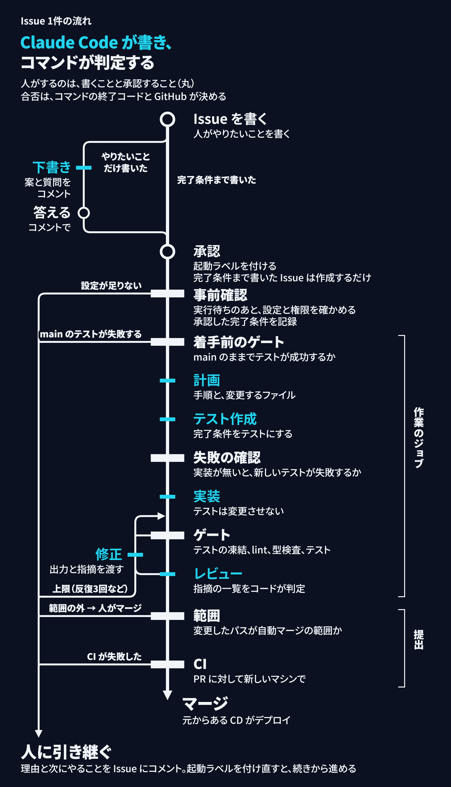
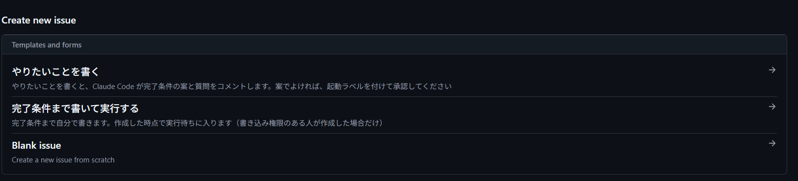
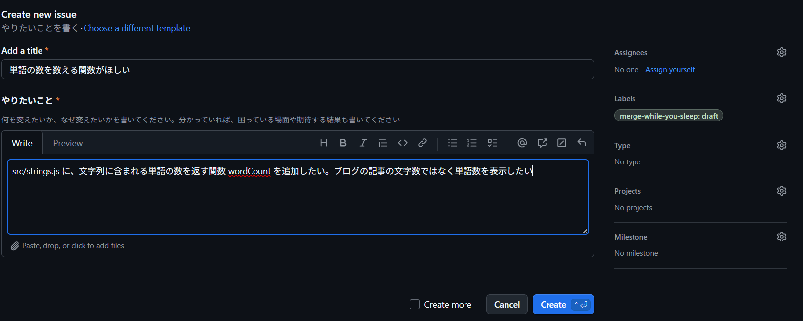
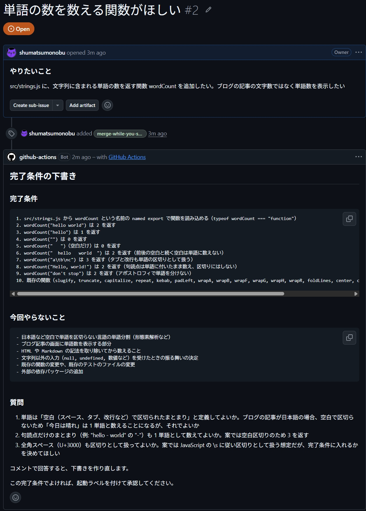
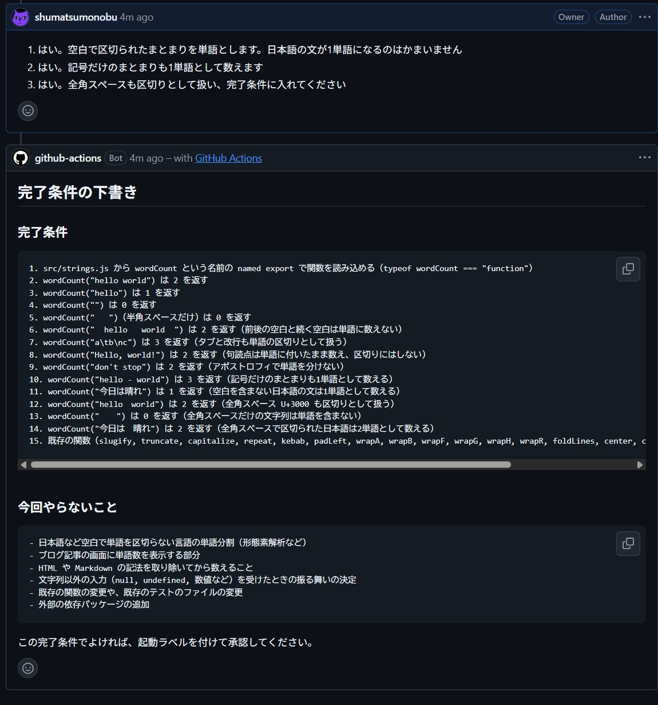
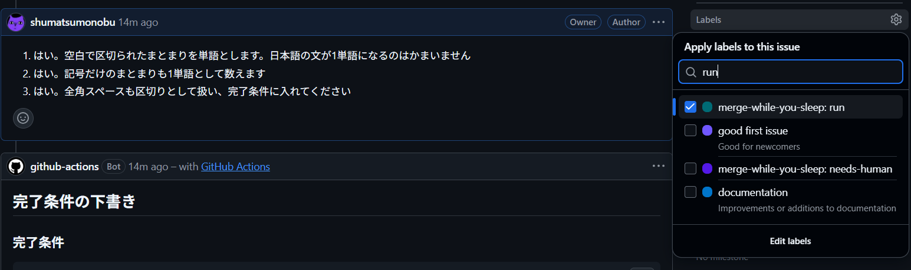
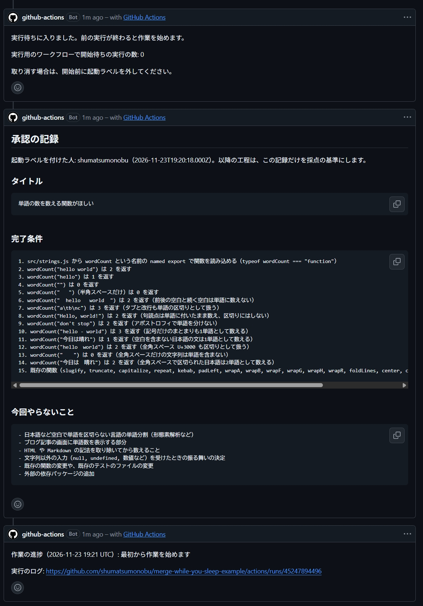
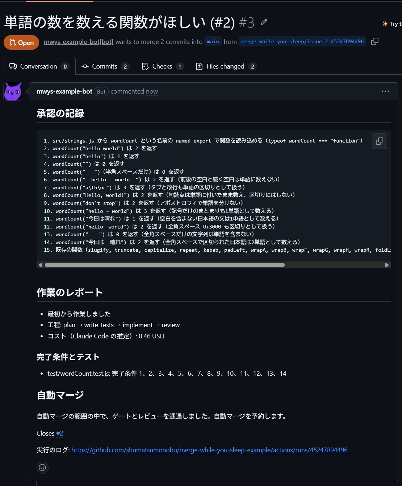
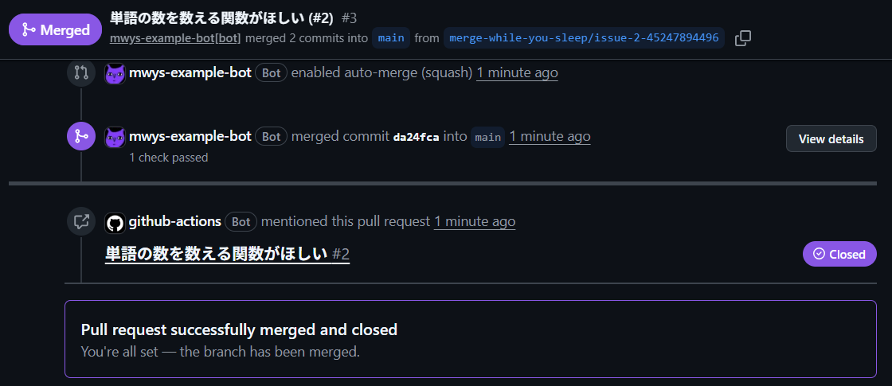

# merge-while-you-sleep

[GitHub](https://github.com/) の Issue にやりたいことを書いて承認すると、[Claude Code](https://code.claude.com/docs) がテストを書いて実装し、ゲートをすべて通過した変更だけを自動でマージする。[GitHub Actions](https://docs.github.com/actions) のワークフローと action の一式

- 試験用のリポジトリで6本実行し、5本がマージまで進んだ。1本あたり 176〜248 秒、0.34〜0.47 USD（Claude Code の推定値）。残りの1本は「完了条件が足りない」として人に引き継いだ
- 人の操作は、完了条件まで書いた Issue なら Issue の作成の1回だけ

この README は自分のリポジトリに導入するかを判断する開発者と、導入する開発者に向けたもの。仕組みと設計判断の理由は [docs/design/](docs/design/)、測定の記録は [measurements/](measurements/)

## 目次

- [概要](#概要)
- [導入の条件](#導入の条件)
- [導入](#導入)
- [使い方](#使い方)
- [合否の判定](#合否の判定)
- [名前と置き場所の変更](#名前と置き場所の変更)
- [ワークフローに step を追加するときの注意](#ワークフローに-step-を追加するときの注意)
- [測定結果](#測定結果)
- [ディレクトリ](#ディレクトリ)

## 概要



- 人の作業: やりたいことを書くこと、完了条件を承認すること
- 止まったとき: 理由と次にやることを Issue にコメント
- デプロイ: 扱わない。default ブランチへのマージで CD が動くリポジトリでは、人がコードを読まずに本番環境まで進む

## 導入の条件

次のすべてに当てはまるリポジトリ

- 公開リポジトリか、GitHub の有料プラン（Pro、Team、Enterprise）のリポジトリ
- Claude Code のサブスク（Pro か Max）がある
- マージ先が default ブランチ
- runner が GitHub ホストの Ubuntu（`ubuntu-24.04`）。self-hosted runner は対象外
- マージキューと、署名付きコミットの必須化を使っていない

次の場合は導入できるが動きが変わる

- PR の承認を必須にしている: CI が成功した時点で毎回承認待ちとして人に引き継ぐ。承認するとマージされる
- テストが外部と通信する: 作業の action の入力 `gate_network` と `network_allow_domains` で許可する。既定ではゲートと Claude Code は外部と通信できない環境で動く

理由は [adoption.md の「導入の前提」](docs/design/adoption.md#導入の前提)

## 導入

コマンドは自分のリポジトリを clone したディレクトリで実行する。[GitHub CLI](https://cli.github.com/)（`gh`）が必要

この手順のとおりに入れた試験用のリポジトリで、2本（完了条件まで書いた Issue と、下書きから始めた Issue）がマージまで進んだ（[results.md の「導入の手順の検証」](docs/design/results.md#導入の手順の検証)）。同じ手順で導入した [merge-while-you-sleep-example](https://github.com/shumatsumonobu/merge-while-you-sleep-example) で、導入したあとの形を見られる

### GitHub App を作成する

PR の作成に使う。`GITHUB_TOKEN` で作成した PR では CI の実行が承認待ちになって止まる（GitHub Docs の [Triggering a workflow](https://docs.github.com/en/actions/how-tos/write-workflows/choose-when-workflows-run/trigger-a-workflow)）

https://github.com/settings/apps/new （Settings → Developer settings → GitHub Apps → New GitHub App）で次のとおりに作成する。表に無い項目は既定のまま

| 項目 | 設定 |
|---|---|
| GitHub App name | 任意の名前（GitHub 全体で重複しないもの。例: `<リポジトリ名>-bot`） |
| Homepage URL | 自分のリポジトリの URL |
| Webhook の Active | 外す（Webhook URL は空のまま） |
| Repository permissions の Contents | Read and write（push と、マージの設定の読み取り） |
| Repository permissions の Pull requests | Read and write（PR の作成と更新、自動マージの予約） |
| Repository permissions の Actions | Read and write（失敗した CI の再実行、使い終わった artifact の削除） |
| Repository permissions の Administration | Read-only（ブランチ保護と、ワークフローのトークンの既定の権限の読み取り） |
| Repository permissions の Issues | Read and write（マージ後に `Closes #<番号>` で Issue を閉じる。無いと閉じない） |
| Repository permissions の Workflows | 付けない（`.github/workflows` の変更を push させない） |
| Where can this GitHub App be installed? | Only on this account |

Repository permissions は欄を開いて設定する。Metadata は Read-only で自動的に付く（必須）。ほかの権限は No access のまま

作成したあと

1. General の Client ID（App ID ではない）を控える
2. 左のメニューの Credentials → Key pairs → New key で秘密鍵を作成する。`.pem` がダウンロードされる
3. 左のメニューの Install App → Install → Only select repositories で、使うリポジトリだけを選んでインストールする

### Secrets と変数を登録する

自分のリポジトリを clone したディレクトリで実行する。gh は、そのリポジトリの管理者のアカウントでログインしておく（`gh auth status` で確かめる。複数のアカウントでログインしている場合は `gh auth switch` で切り替える）

1. Claude Code のトークンを登録する
   1. `claude setup-token` を実行し、表示されたトークン（`sk-ant-oat01-` で始まる文字列）をコピーする。トークンは長く、画面では折り返して2行になる。途中で切れると認証が `HTTP 401` で失敗するので、最後までコピーする
   2. 次を実行し、「Paste your secret」と出たらコピーしたトークンを貼って Enter を押す（貼った文字は `*` で表示される）

      ```bash
      gh secret set CLAUDE_CODE_OAUTH_TOKEN
      ```

2. GitHub App の秘密鍵を登録する。`<ファイル名>` はダウンロードした `.pem` の名前に置き換える

   ```bash
   gh secret set APP_PRIVATE_KEY < ~/Downloads/<ファイル名>.pem
   ```

   登録したあと、手元の `.pem` は削除してよい。GitHub の Secrets からは読み出せないので、必要になったら App の Key pairs で新しい鍵を作成する

3. 変数を登録する。`<Client ID>` は GitHub App の Client ID に置き換える

   ```bash
   gh variable set APP_CLIENT_ID --body "<Client ID>"
   gh variable set MERGE_WHILE_YOU_SLEEP_ALLOW_PATHS --body "src/**,test/**"
   ```

   `MERGE_WHILE_YOU_SLEEP_ALLOW_PATHS` は自動マージの範囲のパターン。カンマか改行で区切る。ソースとテストのディレクトリだけに限定する

### リポジトリの設定を変更する

```bash
# auto-merge と squash マージを許可する
gh api -X PATCH repos/{owner}/{repo} -F allow_auto_merge=true -F allow_squash_merge=true

# ワークフローのトークンを読み取りだけにし、PR の作成と承認を禁止する
gh api -X PUT repos/{owner}/{repo}/actions/permissions/workflow \
  -f default_workflow_permissions=read -F can_approve_pull_request_reviews=false
```

必須のステータスチェックは画面で設定する。Settings → Branches（ブランチ保護）か Settings → Rules（ルールセット）で、default ブランチに、テストを実行する CI のジョブを必須にする。候補に出るのは直近7日以内に実行されたチェックだけなので、CI がまだ動いていなければ先に1回実行する（GitHub Docs の [About protected branches](https://docs.github.com/en/repositories/configuring-branches-and-merges-in-your-repository/managing-protected-branches/about-protected-branches#require-status-checks-before-merging)）

これらの設定は事前確認が実行のたびに確かめる。足りない場合は実行せずに Issue にコメントする

### ラベルを作成する

```bash
gh label create "merge-while-you-sleep: draft"        # 下書きラベル: 下書きを始める
gh label create "merge-while-you-sleep: run"          # 起動ラベル: 承認して実行を始める
gh label create "merge-while-you-sleep: needs-human"  # 引き継ぎラベル: 止まって人の判断を待つ
```

### ワークフローと Issue のテンプレートをコピーする

```bash
git clone --depth 1 https://github.com/shumatsumonobu/merge-while-you-sleep ../merge-while-you-sleep
SHA=$(git -C ../merge-while-you-sleep rev-parse HEAD)

mkdir -p .github/workflows .github/ISSUE_TEMPLATE
cp ../merge-while-you-sleep/templates/workflows/*.yml .github/workflows/
cp ../merge-while-you-sleep/templates/ISSUE_TEMPLATE/*.yml .github/ISSUE_TEMPLATE/

# uses: の @COMMIT_SHA を、コピー元のコミットの SHA に置き換える
perl -pi -e "s/COMMIT_SHA/$SHA/g" .github/workflows/merge-while-you-sleep-*.yml
```

### 実行用のワークフローを自分のプロジェクトに合わせる

`.github/workflows/merge-while-you-sleep-run.yml` の作業のジョブを次のとおりに書き換える

- 作業の action より前の step: プロジェクトの準備（言語の準備、依存のインストール）
- 作業の action の入力 `test_command`: テストのコマンド（既定は `npm test`）

書き換えたら default ブランチに push する

## 使い方

| 人がやること | そのあと起きること |
|---|---|
| テンプレート「やりたいことを書く」で Issue を作成 | Claude Code が完了条件の案と質問をコメントする |
| 質問にコメントで回答 | Claude Code が下書きをし直し、新しい案をコメントする |
| 案に問題が無ければ起動ラベル `merge-while-you-sleep: run` を付ける | 実行待ちに入り、マージまで進む |
| テンプレート「完了条件まで書いて実行する」で Issue を作成 | 作成した時点で実行待ちに入る（書き込み権限のある人の場合だけ） |
| 止まったらコメントの「次にやること」を行い、起動ラベルを付け直す | 開いている PR があり、承認の記録が前回と同じなら、続きから進める |
| 取り消すときは起動ラベルを外す（実行待ちの間）か、GitHub の画面で実行を取り消す（実行中） | 実行が止まる |

- ラベルは Issue の画面の右側にある Labels の歯車から付け外しする
- 同じリポジトリの実行は 1つずつ順に動く
- triage 以上の権限の無い人が書いた Issue: triage 以上の権限を持つ人が下書きラベルを付け直すまで下書きを始めない

### 実行例

[merge-while-you-sleep-example](https://github.com/shumatsumonobu/merge-while-you-sleep-example) で、下書きから始めた Issue（[#2](https://github.com/shumatsumonobu/merge-while-you-sleep-example/issues/2)）が PR（[#3](https://github.com/shumatsumonobu/merge-while-you-sleep-example/pull/3)）のマージまで進んだ画面。人の操作は Issue の作成、質問への回答、起動ラベルを付けることの3つ。起動ラベルを付けてからマージまで3分9秒、コスト（Claude Code の推定）は下書き2回で 0.22 USD、作業の工程で 0.46 USD（1回の実行の値）。コメント、PR、ログの生データは [measurements/e2e-runs/example1/](measurements/e2e-runs/example1/)

1. テンプレート「やりたいことを書く」を選ぶ

   

2. やりたいことを書いて Issue を作成する。下書きラベルはテンプレートが付ける

   

3. Claude Code が完了条件の下書きと質問をコメントする

   

4. 質問にコメントで回答すると、Claude Code が下書きを作り直す

   

5. 下書きでよければ、Labels の歯車から起動ラベル `merge-while-you-sleep: run` を付けて承認する

   

6. 実行待ちの通知、承認の記録、作業の進捗がコメントされる

   

7. PR が作成される。本文は承認の記録、作業のレポート、完了条件とテストの対応、自動マージの判定

   

8. CI が通ると自動でマージされ、Issue が閉じる

   

### 完了条件の例

測定に使った Issue の本文。完了条件は1行に1項目、テストで確かめられる形（入力と期待する結果）で書く

```
### やりたいこと
src/strings.js に foldLines(s, width) を足したい。文字列を、幅 width 以下の行に折り返す

### 完了条件
foldLines("the quick brown fox", 10) は "the quick\nbrown fox" を返す（空白の位置で折り返し、行の区切りは \n）
foldLines("a b c", 1) は "a\nb\nc" を返す
foldLines("abcdefghij", 4) は "abcd\nefgh\nij" を返す（width より長い語は width ごとに切る）
foldLines("a   b", 10) は "a b" を返す（続く空白は1つにまとめる）
foldLines("  a  ", 10) は "a" を返す（前後の空白は除く）
foldLines("", 5) は "" を返す
width が 1 より小さいか整数でないとき（0、-1、1.5、NaN）は RangeError を投げる
新しいテストのファイルに node:test のテストがあり、npm test で既存のテストも含めて全部通る

### 今回やらないこと
既存の関数の変更、既存のテストのファイルの変更、全角文字の幅の扱い、s が文字列以外のときの扱い
```

## 合否の判定

合否を決めるのは Claude Code ではなく、人が承認した完了条件とコマンドの結果

| 仕組み | 内容 |
|---|---|
| 承認の記録 | 承認された完了条件を事前確認が Issue にコメントとして残したもの。採点の基準はこれだけ |
| ゲート | コマンドの終了コードで合否を決める検査（テスト、lint、型検査など）。Claude Code の「完了した」という申告は合否に使わない |
| 着手前のゲート | Claude Code を呼び出す前に default ブランチのままでゲートが成功するかの確認。失敗したら人に引き継ぐ |
| 失敗の確認 | 実装の前に、新しく書いたテストが失敗することの確認。実装が無いのに成功するテストは採点の基準にしない |
| テストの凍結 | 実装と修正の工程にテストのファイルを変更させないこと |
| 自動マージの範囲 | 自動でマージしてよいパスのパターン。範囲の外を変更した PR は人がマージする |

- `.github/` の下、CLAUDE.md、`.claude/` の下などの変更: PR を作成せずに停止。Claude Code が自分の規則やゲートを書き換えられないようにする
- 依存の定義、テストや lint の設定、既存のテストの変更: 自動マージしない
- 認証情報（Claude Code の OAuth トークン、GitHub のトークン、GitHub App の秘密鍵）: Claude Code からもゲートのコマンドからもアクセスできない
  - 攻撃の筋書き14件を確認。runner 上と手元で試した13件はいずれもマージの前に停止。残りの1件はコードを読んで確認（[results.md の「試験結果」](docs/design/results.md#試験結果)）
  - 防御の対象外（self-hosted runner など）は [security.md の「守る対象」](docs/design/security.md#守る対象)

## 名前と置き場所の変更

| 変更すること | 合わせて変更する箇所 |
|---|---|
| ワークフローのファイル名 | 実行待ちの通知の action の入力 `run_workflow` と、事前確認の action の入力 `draft_workflow` |
| ラベルの名前（変数で変更） | Issue のテンプレートの `labels` |
| 依存の置き場所（`node_modules`、`.venv`、`venv`、`vendor` 以外） | 作業の action の入力 `workspace_keep` にそのディレクトリを追加。追加しないとゲートと Claude Code から依存を参照できない |

ラベルの名前、モデル、上限、lint と型検査のコマンドなどは、変数と action の入力で変更できる（[adoption.md の「リポジトリの変数」](docs/design/adoption.md#リポジトリの変数)と[「action ごとの入力」](docs/design/adoption.md#action-ごとの入力)）

## ワークフローに step を追加するときの注意

次の点は事前確認では検出できない

- この仕組みの PR で動く CI に書き込みの権限を付けない。CI に渡す Secrets は Claude Code が書いたコードから読まれる前提で選ぶ
- 作業の action より前の step で作業ディレクトリに認証情報のファイルを置かない（例: [google-github-actions/auth](https://github.com/google-github-actions/auth) は `create_credentials_file: false` にする）
- action の入力 `pass_env` に Secrets を含む環境変数を書かない
- 依存のインストールで git の管理下のファイルを変更しない（例: `npm install` ではなく `npm ci`）
- テンプレートの `cache-mode: read` を変更しない

## 測定結果

| 測ったもの | 結果 |
|---|---|
| Issue の作成からマージまで | 176〜248 秒（5本） |
| 1本のコスト（実装と修正の工程が `sonnet`、既定） | 0.34〜0.47 USD（3本） |
| 1本のコスト（実装と修正の工程が `opus`） | 0.41〜0.45 USD（2本） |
| 人の操作 | 完了条件まで書いた Issue: 1回（6本とも）。下書きから始めた Issue: 3回（作成、回答、承認。別の課題の2本） |
| 人に引き継いだ頻度 | 6本中1本（完了条件が足りない） |
| ゲートを隔離したときに増える時間 | `npm test` の中央値で 11 ms |

- 課題: [Node.js](https://nodejs.org/) の小さいライブラリ（[examples/](examples/)）に [完了条件の例](#完了条件の例)の関数を1つ追加
- 環境: GitHub ホストの runner `ubuntu-24.04`、Claude Code 2.1.319。action は試験用のリポジトリの中にコピーして呼び出した
- 版: 6本は今の版より前の2つの版で実行。今の版では同じ課題を1本実行し、205 秒、0.45 USD でマージまで進んだ
- コスト: Claude Code の推定値（`total_cost_usd`）。実際に支払う額ではなく、サブスクの利用枠を使う
- ゲートの隔離: ゲートのコマンドを [bubblewrap](https://github.com/containers/bubblewrap) で、認証情報にも外部の通信先にもアクセスできない環境に分けて実行すること

ほかの値と条件は [results.md の「測定結果」](docs/design/results.md#測定結果)

## ディレクトリ

| ディレクトリ | 内容 |
|---|---|
| [actions/](actions/) | 導入する側のワークフローが `uses:` で呼び出す action。ジョブごとに1つ（下書き、実行待ちの通知、事前確認、作業、提出、終了処理） |
| [lib/](lib/) | action が共有する部品 |
| [prompts/](prompts/) | 工程ごとに Claude Code に渡す指示文 |
| [templates/](templates/) | 導入する人がコピーするワークフローと Issue のテンプレート |
| [docs/design/](docs/design/) | 設計書 |
| [figures/](figures/) | README の図（`flow.html` が元で、`flow.png` はそれを画像に変換したもの）と、実行例の画面（`example/`） |
| [tools/figure/](tools/figure/) | 図の HTML を PNG に変換するスクリプト（このリポジトリの保守にだけ使う） |
| [tools/check-links.mjs](tools/check-links.mjs) | Markdown の相対リンクと見出しへのリンクが切れていないかを調べるスクリプト（このリポジトリの保守にだけ使う） |
| [examples/](examples/) | 試験用のリポジトリに導入した例 |
| [measurements/](measurements/) | 測定の記録と、確認用のスクリプト |
| [test/](test/) | 手元のテスト（`npm test`） |

## 参考

- [TAKT](https://github.com/nrslib/takt) の設計を参考にした
- ゲートの考え方（失敗の確認、テストの凍結、ミューテーションテスト）は [loop-engineering-playbook](https://github.com/shumatsumonobu/loop-engineering-playbook) による。失敗の確認は playbook では赤先行と呼ぶ

## 作者

週末ものづくり部 ── [@shumatsumonobu](https://x.com/shumatsumonobu)

## ライセンス

MIT ── [LICENSE](LICENSE)
